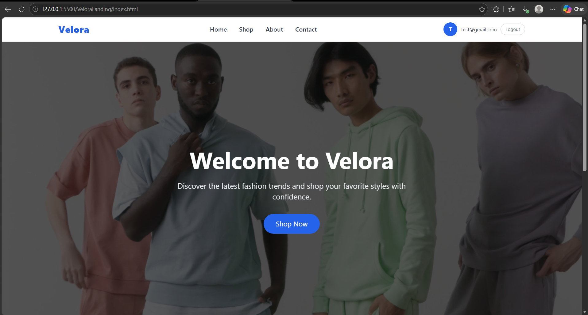
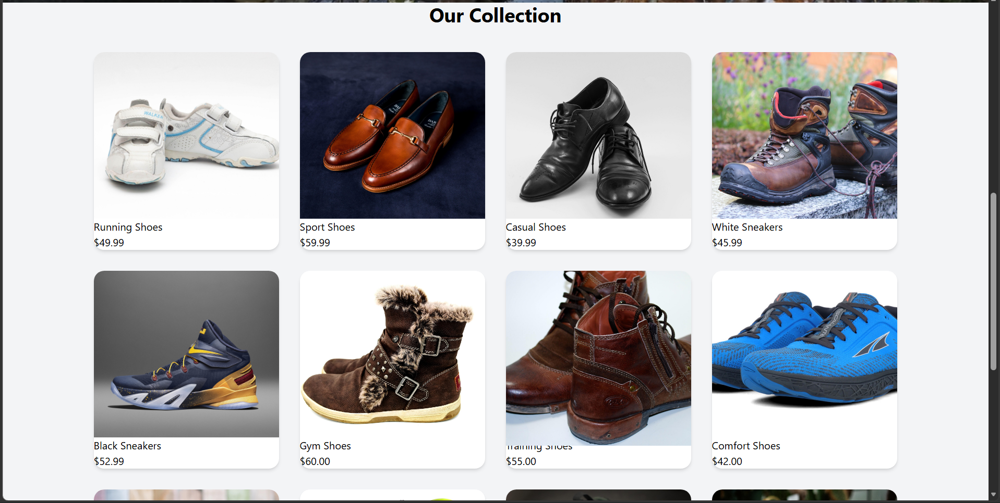
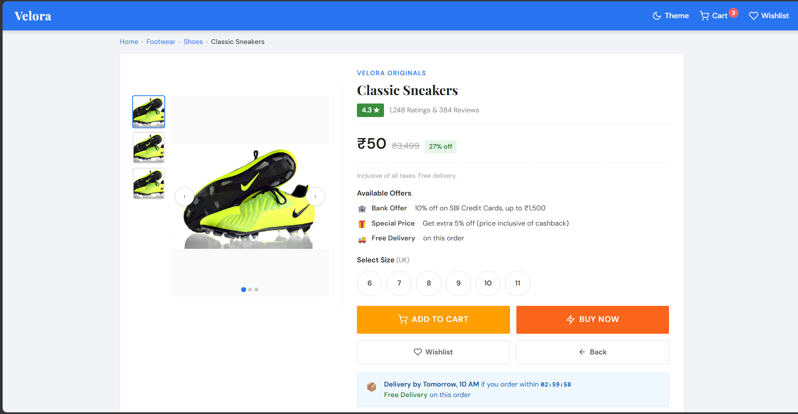

# 👟 Velora — Premium E-Commerce Website

**Velora** is a modern, stylish e-commerce website designed to deliver a premium online shopping experience. It features elegant product displays, an immersive video background, a dedicated shoe collection, and a detailed product page with shopping-related interactions.

## 🌟 Project Overview

Velora combines a clean user interface with modern web technologies to create a visually appealing online footwear shopping experience. The website focuses on product presentation, smooth navigation, and a premium shopping design.

## 📸 Screenshots

### 1. Homepage

Showcase the Velora brand, hero section, and featured collection.



### 2. Shoes Collection

Display the footwear collection in a clean, responsive product grid.



### 3. Product Details Page

A dedicated product page featuring product images, ratings, pricing, available offers, size selection, and shopping actions.



> **Note:** Create a `screenshots` folder in your repository and add your screenshots using the exact filenames shown above. These image links will work after you upload the files.

## ✨ Features

- 🏠 **Premium Homepage** — Modern hero section with video background.
- 👟 **Shoes Collection** — Organized product display with footwear imagery.
- 🛍️ **Product Details** — Dedicated product page with pricing and ratings.
- 📸 **Product Image Gallery** — Multiple product views.
- 📏 **Size Selection** — Options for different shoe sizes.
- 🛒 **Shopping Cart Interface** — Add-to-cart functionality and cart indicator.
- ❤️ **Wishlist Interface** — Wishlist option for products.
- 🌙 **Theme Control** — Theme toggle interface.
- 🎨 **Modern UI** — Clean layouts, hover effects, and attractive styling.
- 📱 **Responsive Design** — Layouts designed for different screen sizes.

## 🛠️ Tech Stack

| Technology | Purpose |
|---|---|
| HTML5 | Website structure |
| Tailwind CSS | Styling and responsive layouts |
| JavaScript | Interactive elements and shopping functionality |
| Node.js & npm | Development tooling and dependency management |
| Git & GitHub | Version control and project hosting |

## 📂 Project Structure

```text
VLOORA-E-COMM-CLONE/
│
├── index.html
├── shoes.html
├── input.css
├── output.css
├── tailwind.config.js
├── postcss.config.js
├── package.json
│
├── images/
│   ├── shoes.jpg
│   ├── shoes1.jpg
│   ├── shoes2.jpg
│   └── ...
│
├── videos/
│   ├── video.mp4
│   └── videos1.mp4
│
├── screenshots/
│   ├── homepage.png
│   ├── shoes-collection.png
│   └── product-details.png
│
└── README.md
```

*Note: This structure illustrates the main project files and expected screenshot locations. Update it if your actual repository structure differs.*

## 🚀 Getting Started

Follow these steps to run Velora on your local machine.

### Prerequisites

Make sure you have installed:

- [Git](https://git-scm.com/)
- [Node.js](https://nodejs.org/) and npm
- [Visual Studio Code](https://code.visualstudio.com/)

### 1. Clone the Repository

```bash
git clone https://github.com/sum347173-creator/VLOORA-E-COMM-CLONE.git
```

### 2. Navigate to the Project Directory

```bash
cd VLOORA-E-COMM-CLONE
```

### 3. Install Dependencies

```bash
npm install
```

### 4. Build Tailwind CSS

If your `package.json` defines a Tailwind build script, run:

```bash
npm run build
```

Otherwise, use the Tailwind CLI command configured for your project.

### 5. Run the Website

Open `index.html` in Visual Studio Code and launch it using the **Live Server** extension.

## 🎯 Project Goals

The main goals of Velora are to:

- Build a premium-looking e-commerce user interface.
- Practice HTML, Tailwind CSS, and JavaScript.
- Improve responsive web design skills.
- Implement product browsing and shopping interactions.
- Understand how to organize and maintain a frontend project.
- Gain practical experience with Git and GitHub.

## 📚 What I Learned

Through this project, I gained practical experience in:

- Creating modern website layouts using Tailwind CSS.
- Working with images and video backgrounds.
- Designing product cards and product detail pages.
- Structuring multi-page websites.
- Implementing JavaScript-based user interactions.
- Managing project files and assets.
- Using GitHub to maintain and showcase a development project.

## 🔮 Future Improvements

- Add user registration and login.
- Integrate a backend API and database.
- Implement persistent shopping cart and wishlist data.
- Add product search, sorting, and filtering.
- Build a secure checkout and order management workflow.
- Add payment gateway integration.
- Deploy the website for public access.

## 👨‍💻 Author

**Sumant Tiwary**

- GitHub: [@sum347173-creator](https://github.com/sum347173-creator)
- Project Repository: [VLOORA-E-COMM-CLONE](https://github.com/sum347173-creator/VLOORA-E-COMM-CLONE)
- LinkedIn: [Connect with me](https://www.linkedin.com/in/sumanttiwary/)

---

⭐ If you like this project, consider giving the repository a star!

**Velora — Step Into Your Style.**
